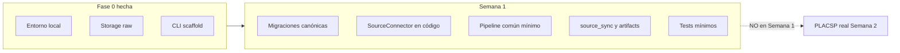

# Semana 1 — Plan: modelo canónico + infraestructura de ingesta

> **Estado:** planificado (revisado); ejecución pendiente hasta OK explícito.  
> **Checklist:** [fase1-checklist.md](fase1-checklist.md)  
> **Precondición:** Fase 0 cerrada ([fase0-checklist.md](fase0-checklist.md); excepción consciente: sin protección de `main`).  
> **Norma:** implementar lo ya fijado en `docs/00`–`04` y `.cursor/rules/`. No editar `docs/00`–`04` salvo petición explícita.  
> **ADRs:** solo si aparece una decisión que **contradiga** o **añada** arquitectura/seguridad/contratos/dependencias estructurales. No son el paso 0 para poder programar.

---

## 1. Estado al arrancar (inspección real)

| Área | Existe | Semana 1 |
|---|---|---|
| Monorepo, CI, web scaffold, CLI `--help` | Sí | Base lista |
| Bucket Storage `raw` (privado) | Sí — migración Fase 0 | Reutilizar |
| Tabla `setup_rls_smoke` + seed Alice/Bob | Sí (smoke) | No es canónico; se mantiene de momento |
| Tablas canónicas (`tenders`, …) | **No** | Por crear (lista ya fijada en roadmap) |
| `source_sync` / `source_artifacts` / `errors` | Solo esbozo en docs | Por crear (campos esbozados en onboarding) |
| `SourceConnector` + pipeline | Protocol y etapas ya descritos en `docs/01` | Por bajar a código Python |
| ADRs | Stub vacío | **No** requisito previo; solo si hace falta de verdad |
| Tests de ingesta | Carpeta vacía | Por crear |
| Tipos TS | Solo `setup_rls_smoke` | Regenerar tras migraciones |

**Conclusión:** hay que **materializar** lo que la arquitectura y el roadmap ya definen. No hay que rediseñar el sistema.

---

## 2. Postura sobre ADRs (revisada)

El roadmap dice *«Crear los ADR iniciales **necesarios**»* y *«ADRs estructurales escritos»* como criterio de salida. **Necesarios** no significa “tres ADRs antes de tocar SQL”.

| Tema | ¿Hace falta ADR? | Por qué |
|---|---|---|
| Tablas del modelo canónico | **No** | Entidades y responsabilidades ya FIJAS en `docs/01` §6 y lista en `docs/04` Semana 1. El DDL concreto es *cómo* (migración), no un cambio de arquitectura. |
| Contrato `discover`/`fetch`/`parse` y pipeline | **No** | Ya FIJO EN EL QUÉ en `docs/01` §5 y `.cursor/rules/07-etl-connectors.mdc`. Solo hay que implementarlo. |
| Identidad NIF/CIF, no usar el nombre como id | **No** | Ya FIJO en `docs/01` §6.2. |
| RLS / service_role fuera del frontend | **No** | Ya FIJO en `docs/01` §7 y reglas de seguridad. Se aplica el mismo criterio que en Fase 0 (`setup_rls_smoke`). |
| Cliente SQL `psycopg` (si se usa) | **No** (salvo sorpresa) | Es librería de acceso a Postgres, no proveedor ni pieza de infra nueva. Se justifica en el PR según estándares Python; ADR solo si se convirtiera en ORM central u otro patrón prohibido. |
| Redis, ES, colas, backend HTTP permanente, otro email… | **Sí, y no se hace** | Están vetados sin ADR; Semana 1 **no** los introduce. |

Si durante la implementación surge un hueco real que obligue a **cambiar** algo fijo → entonces sí se para y se propone un ADR. Si no surge, el criterio de salida se cumple con **ningún ADR nuevo** (anotado en checklist como N/A: sin decisión estructural nueva).

---

## 3. Defaults de implementación (dentro de lo libre)

1. **DDL mínimo** que cumpla responsabilidades del núcleo (identidad, trazabilidad, upsert por fuente, contadores de sync, esqueleto users/alertas). Ampliar columnas en Semana 2 cuando PLACSP lo exija.
2. **Catálogos `cpv` / `geography`:** no en Semana 1 (no están en la lista de tareas del roadmap §5); códigos/texto nullable en `tenders` si hace falta.
3. **Sin PLACSP real:** stub/fake solo para demostrar contrato + pipeline + sync/artifacts.
4. **Acceso DB en ETL:** SQL directo con cliente ligero (`psycopg` v3), justificado en el PR; sin ORM como dependencia arquitectónica.
5. **RAW:** reutilizar bucket `raw`; `store_raw` mínimo (ruta + checksum en `source_artifacts`).
6. **RLS:** tablas de usuario owner-only; tablas de dominio público con SELECT acotado según reglas ya escritas; escritura de ingesta con `service_role`.
7. **`setup_rls_smoke`:** se mantiene.
8. **Pasos pequeños** en Agent; un bloque verificable por turno.

---

## 4. Orden de trabajo (pasos verificables)

### Paso 1 — Migración operativa de ingesta

Crear tablas ya pedidas por el roadmap, con el esbozo de `source_sync` de `docs/00`:

- `source_sync`, `source_artifacts`, `errors`
- Índices B-tree básicos (`source_code`, status, timestamps)
- RLS/grants alineados con `docs/01` §7 (mismo espíritu que Fase 0)

**Verificación:** `supabase db reset` local OK.

### Paso 2 — Migración del núcleo canónico

Tablas de la lista Semana 1:

- `contracting_authorities`, `suppliers`
- `tenders`, `tender_sources` (unique fuente + id en fuente), `tender_events`, `documents`
- Identidad fiscal nullable + señal primaria cuando exista (regla ya fijada)

**Verificación:** `db reset`; FKs e uniques correctos.

### Paso 3 — Esqueleto usuarios / alertas

- `users` (ligado a `auth.users`), `saved_searches`, `alerts`, `notification_queue` (con `idempotency_key`)
- RLS owner-only

**Verificación:** `db reset`; no romper seed Alice/Bob / smoke.

### Paso 4 — Tipos TS + CHANGELOG

- `supabase gen types typescript --local` → `packages/types`
- Entrada en `CHANGELOG.md`

**Verificación:** `pnpm -r typecheck` verde.

### Paso 5 — `SourceConnector` en código

Bajar a Python el Protocol ya descrito en `docs/01` §5.2:

- `discover` / `fetch` / `parse`
- Tipos Pydantic en el límite (`SyncContext`, `RemoteArtifact`, `SourceRecord`, …)
- Stub sin red

**Verificación:** tests básicos del contrato.

### Paso 6 — Pipeline común mínimo

Etapas ya listadas en roadmap/`docs/01`, como módulos invocables. Semana 1: pass-through documentado donde aún no hay dominio; **sí** cablear registro sync/artifacts y `store_raw` mínimo.

**Verificación:** test mínimo del runner con stub.

### Paso 7 — Sync + artifacts “funcionando”

Abrir/cerrar run, artifact + checksum, contadores, reejecución del stub sin corromper.

**Verificación:** contra Postgres local (test acotado).

### Paso 8 — Tests + CI

- `pytest` en `ingestion/`
- CI: añadir `uv run pytest` al job de ingestion

### Paso 9 — Cierre Semana 1

Contrastar [fase1-checklist.md](fase1-checklist.md). ADR solo si en los pasos 1–8 hubo decisión estructural nueva; si no, marcar N/A.

**Fuera de alcance:** parser PLACSP, `ingest-*.yml`, dedup real, FTS, Auth UI, Resend.

---

## 5. Para qué sirve cada bloque

| Bloque | En una frase |
|---|---|
| Migraciones sync/artifacts | Bitácora de cada ingesta + evidencia de cada fichero |
| Migración canónica | El modelo único que consumirá la web (ya definido; ahora existe en SQL) |
| Esqueleto users/alertas | Reserva el sitio con RLS; la lógica llega en Semana 5 |
| `SourceConnector` | Cada fuente solo descubre, descarga y parsea |
| Pipeline | Lógica común de EfiLicit sin duplicarla por fuente |
| Tests + CI | Que el andamiaje no se rompa en cada PR |

---

## 6. Puntos abiertos (implementación, no arquitectura)

1. ¿Varias migraciones (operativa → canónica → users) o una sola? Preferencia: **varias**, para revisar en Agent.
2. Alcance de `store_raw` en Semana 1: metadata + checksum (+ mock Storage en tests) vs subida real al bucket local.
3. ¿`anon` puede hacer SELECT de `tenders` desde Semana 1 o solo `authenticated`? (detalle de policy; la regla de seguridad ya existe.)
4. Push de migraciones al remoto solo con OK explícito.

---

## 7. Decisiones durante la ejecución

> Rellenar al cerrar cada paso. Aquí vive el orden de acuerdos del proyecto.

| Cuándo | Decisión | Motivo / consecuencia |
|---|---|---|
| Planificación inicial | Tres ADRs previos (modelo, psycopg, RLS) | Descartado: repetía lo ya fijado en `docs/01` |
| Revisión de plan | Implementar Semana 1 **siguiendo** arquitectura/roadmap; ADR solo si hay cambio estructural real | Evitar usar ADRs como licencia para reinventar |
| *(pendiente)* | | |

---

## Referencias

- [docs/04-roadmap-mvp.md](../04-roadmap-mvp.md) § Semana 1
- [docs/01-arquitectura-fija.md](../01-arquitectura-fija.md) §§ 5–8
- [docs/00-onboarding.md](../00-onboarding.md) (esbozo `source_sync`)
- [fase0-checklist.md](fase0-checklist.md) · [fase1-checklist.md](fase1-checklist.md)
- [semana00-plan.md](semana00-plan.md)
